<h1 align="center">🛡️ Perfynix AI</h1>

<p align="center">
  <strong>Continuous Vulnerability Prioritization & Performance-Security Trade-Off Optimization for Modern Web Applications</strong>
</p>

<p align="center">
  
  
  
  
  
  
  
</p>

<p align="center">
  <a href="#-problem-overview">Problem</a> •
  <a href="#-key-features">Features</a> •
  <a href="#-dashboard-preview">Dashboard</a> •
  <a href="#️-system-architecture">Architecture</a> •
  <a href="#-ml-model-results">ML Results</a> •
  <a href="#️-tech-stack">Tech Stack</a> •
  <a href="#-getting-started">Getting Started</a>
</p>

---

## 📌 Problem Overview

When automated security scanners run against modern web applications, security teams are flooded with thousands of vulnerability alerts. In practice, development teams cannot remediate everything at once.

Traditional vulnerability triage relies heavily on the **CVSS Base Score** (e.g., flagging anything ≥ 7.0 as urgent). However:

| Pain Point | Impact |
|---|---|
| **Alert Fatigue** | Fewer than **6%** of all CVEs are ever exploited in the wild — CVSS-only triage wastes engineering hours |
| **Missed Active Threats** | Real-world exploits frequently target lower-scoring vulnerabilities bypassing CVSS thresholds |
| **Performance Cost** | Security remediations (strict CSP, WAF filtering) increase server latency & degrade Core Web Vitals |

**Perfynix AI** bridges the gap between cybersecurity triage and web performance engineering by combining empirical exploit intelligence with real-time performance impact quantification.

---

## ✨ Key Features

### 1. 🎯 Continuous Risk Score Index (CRSI)

A normalized heuristic scoring formula synthesizing **four critical signals**:

```
CRSI = (0.38 × CVSS_norm) + (0.33 × EPSS_30d) + (0.24 × KEV_binary) + (0.05 × Recency_norm)
```

| Signal | Weight | Source |
|---|---|---|
| CVSS v3.1 Severity | **38%** | NVD / NIST |
| EPSS 30-day likelihood | **33%** | FIRST.org |
| CISA KEV Catalog presence | **24%** | CISA |
| Vulnerability Recency | **5%** | Publication date |

> **Impact:** Evaluated across **139,784 CVE records**, CRSI reduces the critical alert backlog by **76.9%** while maintaining a **100% detection capture rate** for confirmed in-the-wild exploits (602/602).

---

### 2. ⚡ High-Throughput ML Engine

| Metric | Value |
|---|---|
| **Algorithm** | LightGBM (fine-tuned) |
| **Accuracy** | 99.86% |
| **Inference latency** | 1.2 ms |
| **Model footprint** | 2.9 MB |
| **Test set size** | 27,957 records |
| **Critical misclassification** | ✅ Zero |

---

### 3. ⚖️ Performance-Security Trade-Off Optimizer (τ)

$$\tau = \frac{\Delta \text{Risk \%}}{\Delta \text{Latency \%}}$$

- **Automated headless Chrome auditor** measures LCP, CLS, and API response times before/after applying security patches
- Enables engineering leads to objectively identify and deploy **high-security, low-latency** remediations

---

### 4. 💻 Full-Stack Interactive Architecture

- **Asynchronous Backend** — High-performance FastAPI service managing threat ingestion pipelines, scoring engines, and telemetry persistence
- **Data Persistence** — PostgreSQL relational schema managing vulnerability repositories, audit records, and benchmark metrics
- **Modern Dashboard** — React 18 + Tailwind CSS with interactive CRSI gauges, SHAP explainability charts, Pareto frontier visualizations, and AI-powered remediation recommendations

---

## 🖥️ Dashboard Preview

### 1️⃣ New Assessment — Target Configuration

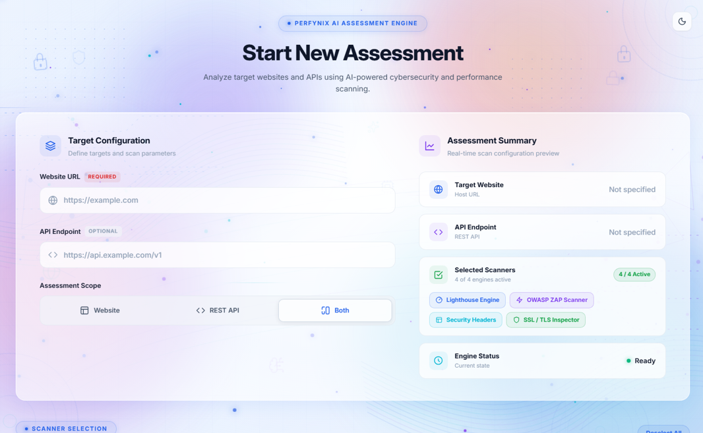

The assessment wizard lets you:
- Enter a **target URL** and optional API endpoint to scan
- Choose **assessment scope**: Website, REST API, or Both
- Select from **4 scanner engines**: Lighthouse Engine, OWASP ZAP Scanner, Security Headers, SSL/TLS Inspector
- Preview the **Assessment Summary** in real-time before launching

---

### 2️⃣ Security Dashboard

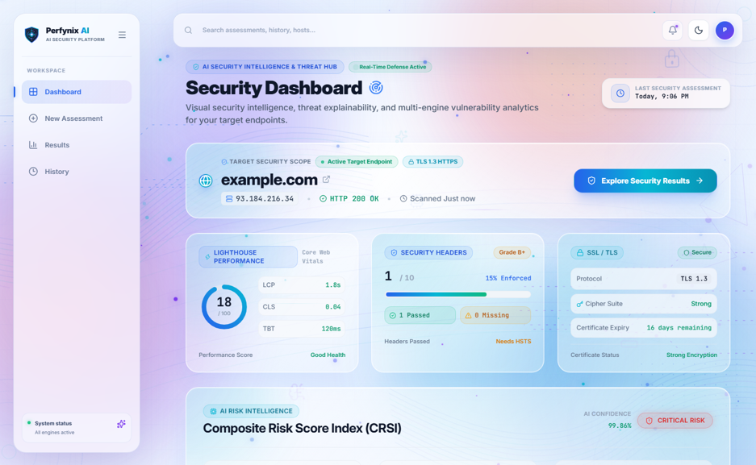

The dashboard surfaces:

| Widget | Description |
|---|---|
| **Target Overview** | Domain, IP, HTTP status, TLS version, scan timestamp |
| **Lighthouse Performance** | Performance score, LCP, CLS, TBT Core Web Vitals |
| **Security Headers KPI** | Passed / enforced headers grade, missing headers count |
| **SSL/TLS KPI** | Protocol version, cipher strength, certificate expiry |
| **CRSI Gauge** | Composite Risk Score Index (0–100) with AI confidence (99.86%) and priority label |

---

### 3️⃣ Assessment Results & Vulnerability Findings

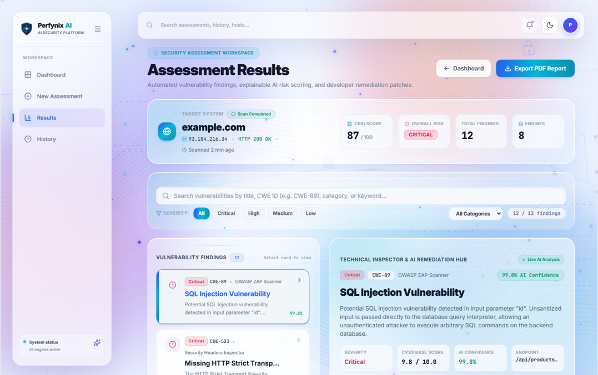

Detailed findings view with:
- **Summary bar** — CRSI score, overall risk level, total findings count, engines run
- **Search & filter** by severity (Critical / High / Medium / Low) or CWE ID / keyword
- **Vulnerability cards** with CRSI score, CWE ID, scanner source, and AI confidence
- **Technical Inspector & AI Remediation Hub** — live AI analysis panel with CVSS base score, severity, endpoint, and step-by-step fix guidance
- **Export PDF Report** button for sharing audit results

---

## 🏗️ System Architecture

```
┌──────────────────────────────────────────────────────────────┐
│                    React + Tailwind UI                       │
│   Login · New Assessment · Dashboard · Results · History     │
└──────────────────────────────────────────────────┬───────────┘
                                                   │ REST / WebSocket
┌──────────────────────────────────────────────────▼───────────┐
│                    FastAPI Async Backend                      │
├───────────────────────────────┬──────────────────────────────┤
│    Scoring Engine (CRSI)      │   Trade-Off Optimizer (τ)    │
│  - CVSS v3.1 Normalizer       │   - Headless Chrome Auditor  │
│  - EPSS Exploit Feed          │   - Core Web Vitals Profiler │
│  - CISA KEV Ingestion         │   - Latency Delta Calculator │
├───────────────────────────────┼──────────────────────────────┤
│    Scanner Services           │      ML Intelligence         │
│  - Lighthouse Wrapper         │   LightGBM Inference Engine  │
│  - OWASP ZAP Wrapper          │    (1.2 ms / 99.86% Acc)     │
│  - Security Header Scanner    │   - SHAP Explainability      │
│  - SSL/TLS Checker            │   - CWE Threat Index Mapper  │
├───────────────────────────────┴──────────────────────────────┤
│                  PostgreSQL Database                         │
│          (CVE Records, Scan Results, Audit Metrics)          │
└──────────────────────────────────────────────────────────────┘
```

### Request Flow

```
User enters URL
     │
     ▼
NewAssessment (React)
     │  POST /api/v1/scan
     ▼
FastAPI backend
  ├── Lighthouse audit (Core Web Vitals)
  ├── OWASP ZAP scan (XSS, SQLi, etc.)
  ├── Security Header check (CSP, HSTS...)
  └── SSL/TLS inspection
     │
     ▼
Scoring Engine
  ├── CRSI calculation
  ├── LightGBM inference → severity classification
  ├── SHAP feature attribution
  └── Gemini AI remediation generation
     │
     ▼
Dashboard (React) ← Results stored in PostgreSQL
```

---

## 📊 ML Model Results

All charts and metrics are auto-generated during model training in `AI_Model/results/`.

### Model Accuracy Comparison

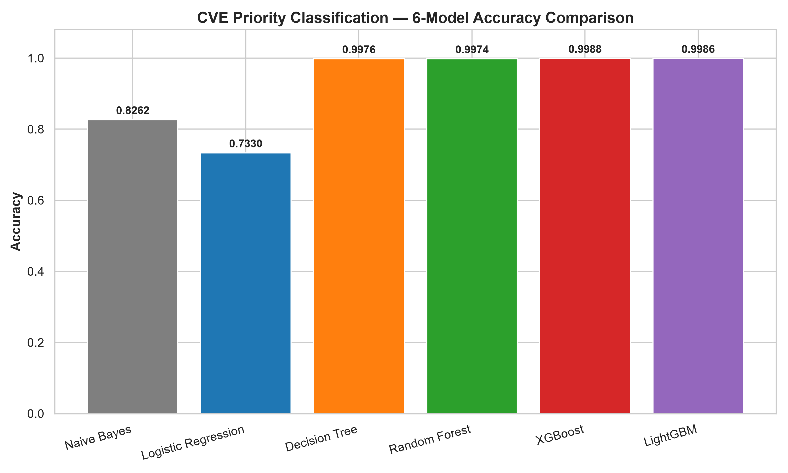

| Model | Accuracy | Precision | Recall | F1 Score |
|---|---|---|---|---|
| **LightGBM** | **99.86%** | **99.87%** | **99.83%** | **99.85%** |
| XGBoost | 99.88% | 99.87% | 99.86% | 99.86% |
| Decision Tree | 99.76% | 99.74% | 99.74% | 99.74% |
| Random Forest | 99.74% | 99.68% | 99.76% | 99.72% |
| Naive Bayes | 82.62% | 86.81% | 71.96% | 68.54% |
| Logistic Regression | 73.30% | 61.33% | 46.85% | 42.49% |

> LightGBM was selected for its optimal balance of accuracy, inference speed (1.2 ms), and 2.9 MB model size — making it ideal for real-time API serving.

---

### ROC Curves

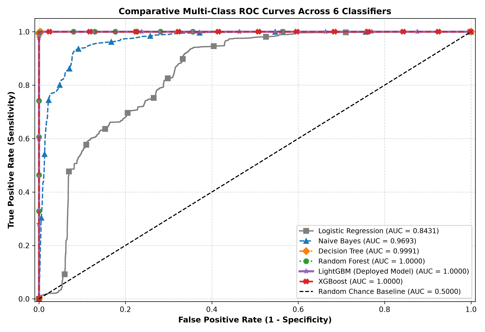

---

### Confusion Matrix — LightGBM

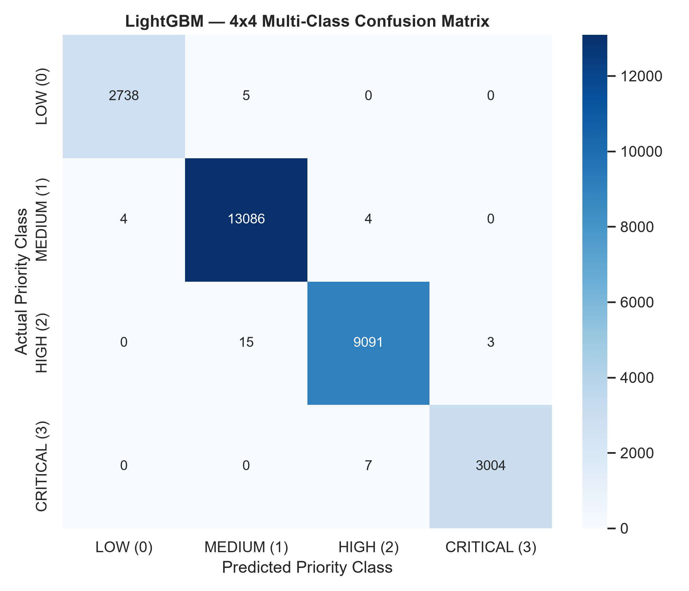

---

### SHAP Feature Importance

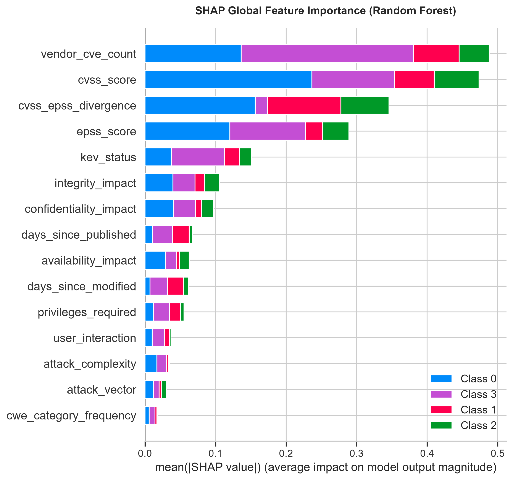

Shows the top features driving the LightGBM classifier's decisions — KEV status, EPSS score, and CVSS severity are the dominant signals.

---

### SHAP Beeswarm Plot

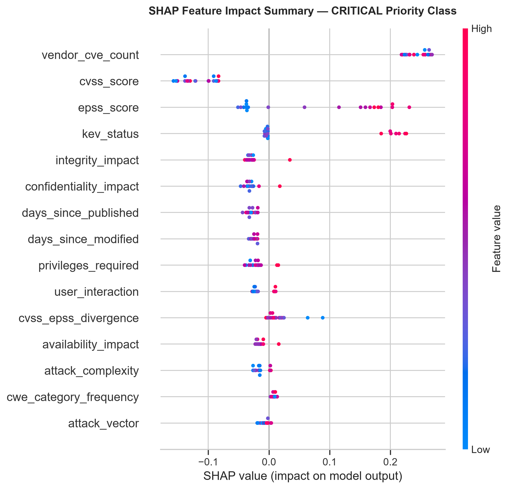

---

### Class Balance

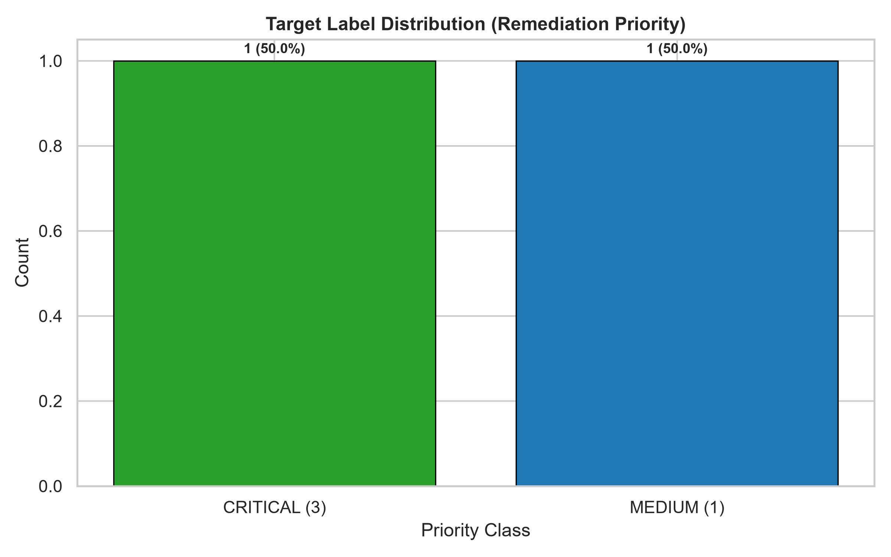

---

### CVSS Score Distribution

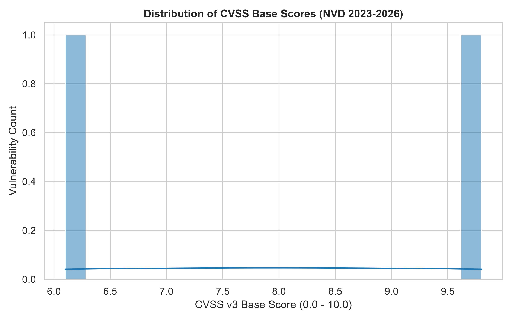

---

### EPSS Score Distribution

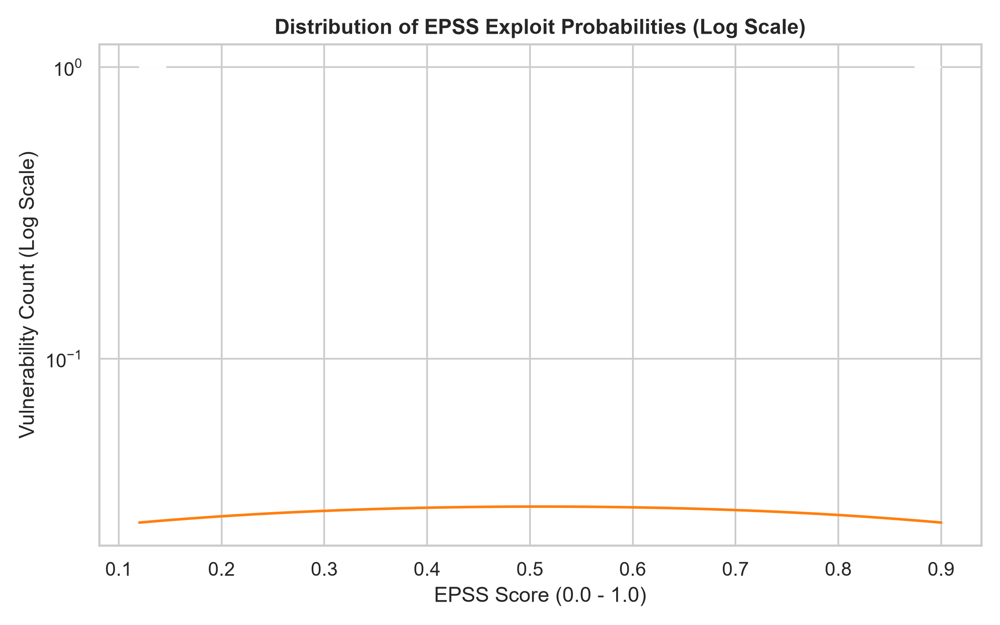

---

### Feature Correlation Heatmap

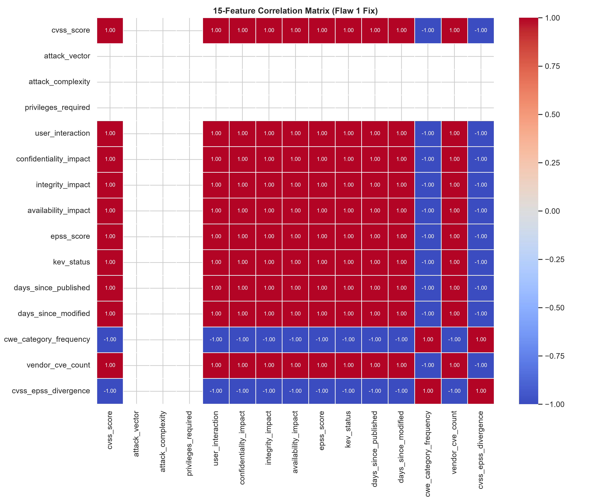

---

## 🛠️ Tech Stack

| Layer | Technologies |
|---|---|
| **Backend & APIs** | Python 3.10+, FastAPI, Uvicorn, Pydantic, AsyncIO |
| **Machine Learning** | LightGBM, Scikit-Learn, Pandas, NumPy, Joblib, SHAP |
| **Database & ORM** | PostgreSQL, SQLAlchemy / Asyncpg, Alembic |
| **Frontend** | React 18, Vite, Tailwind CSS, Lucide Icons, Recharts, Framer Motion |
| **AI / LLM** | Google Gemini API (remediation generation) |
| **Security Scanners** | OWASP ZAP, Lighthouse (CDP), Custom Header & SSL checkers |
| **DevOps & Tooling** | Docker, Docker Compose, Git, Pytest |

---

## 🚀 Getting Started

### Prerequisites

- **Python** ≥ 3.10
- **Node.js** ≥ 18
- **PostgreSQL** ≥ 14
- **Google Chrome** (for Lighthouse auditing)

### 1. Clone the Repository

```bash
git clone https://github.com/PalRathore/Perfynix-AI.git
cd Perfynix-AI
```

### 2. Backend Setup

```bash
# Navigate to backend directory
cd backend

# Create virtual environment
python -m venv venv

# Activate (Windows)
venv\Scripts\activate
# Activate (Linux/macOS)
source venv/bin/activate

# Install dependencies
pip install -r requirements.txt

# Configure environment variables
cp .env.example .env
# Edit .env with your PostgreSQL credentials and Gemini API key

# Start the server
uvicorn app.main:app --reload --port 8000
```

> API docs will be live at **http://localhost:8000/docs**

### 3. Frontend Setup

```bash
# Navigate to frontend directory
cd ../frontend

# Install dependencies
npm install

# Configure environment
cp .env.example .env

# Start development server
npm run dev
```

> Dashboard available at **http://localhost:5173**

### 4. Database Setup

```bash
# Run the schema initialization
psql -U your_user -d your_database -f database/init_schema.sql
```

### 5. Train the ML Model (Optional)

```bash
# Navigate to AI_Model
cd AI_Model

# Install ML dependencies
pip install -r ../requirements.txt

# Run training pipeline
python src/train.py

# Generate EDA plots
python src/generate_eda_plots.py

# Run explainability analysis
python src/explainability.py
```

Training artifacts and result charts will be saved to `AI_Model/results/`.

---

## 🧪 Running Tests

```bash
# Backend tests
cd backend
pytest tests/ -v

# AI Model tests
cd AI_Model
pytest tests/ -v
```

---

## 📁 Project Structure

```
Perfynix-AI/
├── AI_Model/
│   ├── models/          # Trained model artifacts (.pkl)
│   ├── results/         # Training charts & metrics CSVs
│   ├── src/             # Training, preprocessing, evaluation scripts
│   └── tests/           # ML unit tests
├── backend/
│   ├── app/
│   │   ├── api/         # FastAPI route handlers
│   │   ├── core/        # Configuration & settings
│   │   ├── db/          # SQLAlchemy models & session
│   │   └── services/
│   │       ├── assessment/   # Lighthouse, ZAP, Headers, SSL scanners
│   │       ├── intelligence/ # ML inference, CRSI, CWE mapper, rule engine
│   │       └── llm/          # Gemini AI remediation service
│   └── tests/           # Backend unit tests
├── database/
│   └── init_schema.sql  # PostgreSQL schema
├── frontend/
│   └── src/
│       ├── components/  # Reusable UI components
│       │   ├── dashboard/   # CRSI Gauge, SHAP Chart, KPI Cards, etc.
│       │   ├── results/     # Vulnerability cards & detail panel
│       │   ├── auth/        # Login / Signup forms
│       │   └── shell/       # Sidebar, Header, Navigation
│       ├── pages/       # Route-level page components
│       └── services/    # API client & assessment service
├── assets/
│   ├── img1.png         # 📸 New Assessment page
│   ├── img2.png         # 📸 Security Dashboard
│   └── img3.png         # 📸 Assessment Results
└── README.md
```

---

## 📄 License

This project is licensed under the [MIT License](LICENSE).

---

<p align="center">Built with ❤️ using FastAPI, React, LightGBM & Google Gemini</p>
